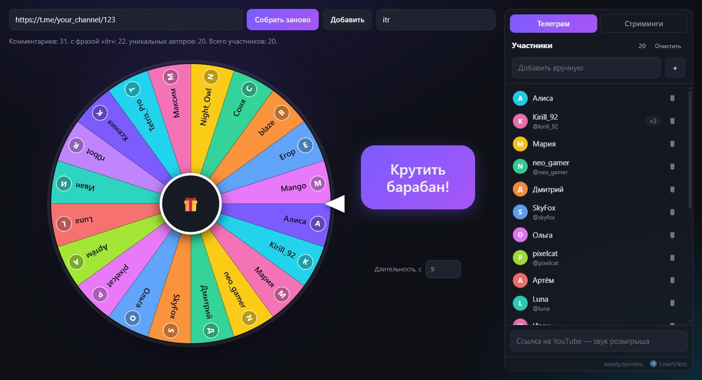
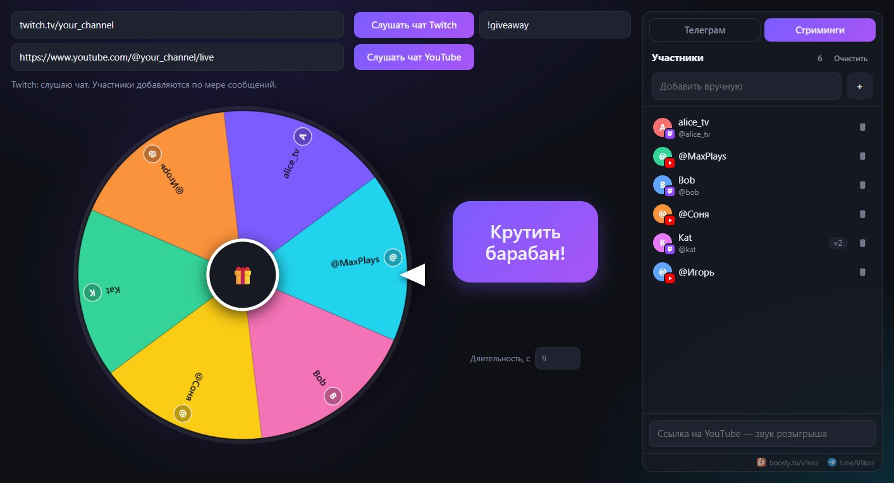
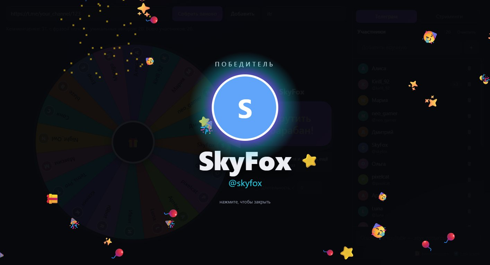

# Крутка Vilknz · Vilknz prize wheel

Колесо для розыгрышей среди комментаторов поста в Telegram и зрителей трансляций на Twitch и YouTube.
Вставляете ссылку — программа собирает уникальных участников, жмёте «Крутить барабан!» — колесо выбирает победителя.

Портативная программа для Windows: один exe-файл, без установки и без входа в аккаунты.



## Возможности

- **Telegram** — собирает всех, кто прокомментировал пост публичного канала. Можно добавить участников
  с нескольких постов.
- **Twitch и YouTube** — слушает чат идущей трансляции; участники появляются в списке по мере сообщений.
  Оба чата можно слушать одновременно.
- **Ключевая фраза** — участвуют только те, кто её написал. Регистр не важен, русские и английские буквы
  равнозначны: `itr` = `ИТР` = `iTr`.
- **Один человек — один лот.** Сколько бы раз участник ни написал, шанс у всех равный; число сообщений
  показано рядом с ником.
- **Честный выбор** — победитель определяется криптографически стойким генератором (`crypto.getRandomValues`)
  до начала анимации, колесо просто докручивается до него.
- Список участников можно править: удалить, вернуть, добавить вручную.
- Аватарки участников и канала/стримера в центре колеса, значки Twitch/YouTube у участников из чатов.
- Музыка с YouTube на время прокрутки, настраиваемая длительность вращения.
- Таймер до крутки с паузой, сбросом и вводом своего времени.
- Праздничный экран победителя и кнопка «Убрать победителя и крутить ещё раз» для нескольких призов.

| Чаты трансляций | Победитель |
|---|---|
|  |  |

## Как запустить

1. Скачайте `VilknzPrizeWheel.exe` из раздела [Releases](../../releases/latest) и положите в любую папку.
2. Запустите его. Откроется небольшое окно консоли, а в браузере по умолчанию — страница программы
   (`http://127.0.0.1:8765/`). Вся работа идёт на этой странице.
3. **Не закрывайте окно консоли, пока проводите розыгрыш** — без него не работает сбор участников.
   Закройте его, когда розыгрыш закончен, — программа выключится. Повторный запуск при уже открытой
   программе просто откроет страницу ещё раз.

Если порт 8765 занят другой программой, Крутка сама займёт следующий свободный (8766 и далее) и напишет
об этом в окне консоли.

Установка не нужна: программа ничего не пишет рядом с собой и в систему. Настройки (длительность, ссылки)
хранятся в браузере.

**Windows может предупредить** «Windows защитила ваш компьютер», потому что у файла нет платной цифровой
подписи. Нажмите «Подробнее» → «Выполнить в любом случае». Некоторые антивирусы ложно срабатывают на
программы, собранные PyInstaller; если сомневаетесь — запустите из исходного кода (ниже) или соберите exe сами.

## Как пользоваться

Источник участников выбирается вкладками над списком справа.

**Телеграм**

1. Вставьте ссылку на пост: `https://t.me/канал/123`. Канал должен быть публичным, с открытыми комментариями.
2. **Собрать заново** — очистить список и собрать с этой ссылки. **Добавить** — дописать авторов с ещё
   одного поста к уже собранным (повторы не дублируются).

**Стриминги**

1. Вставьте ссылку на канал Twitch (`twitch.tv/канал`) и/или на идущую трансляцию YouTube
   (ссылка на видео или `youtube.com/@канал/live`).
2. **Слушать чат** — участники добавляются по мере сообщений, пока не нажать **Остановить**.
   Истории чата нет: учитываются только сообщения после подключения.
3. При нажатии «Крутить барабан!» прослушивание останавливается; чтобы собирать дальше, нажмите «Слушать чат» снова.

**Общее**

- **Ключевая фраза** — если заполнена, участвуют только те, кто её написал; без неё — все, кто написал что угодно.
  Фраза должна стоять отдельным словом: «хочу itr!» подходит, «itrx» — нет.
- **Крутить барабан!** — окно победителя закрывается кликом; после этого загорается «Убрать победителя и
  крутить ещё раз».
- **Таймер «До крутки»** над кнопкой — отсчёт до розыгрыша (по умолчанию 10 минут): ▶ запускает, ⏸ ставит на паузу,
  «−1 мин» / «+1 мин» меняют время, клик по цифрам позволяет ввести своё (`5` — пять минут, `2:30`, `1:00:00`),
  «Сброс» возвращает к времени, с которого начинали. Когда время выходит, кнопка «Крутить барабан!» начинает
  мигать — крутку всегда запускаете вы сами.
- **Длительность, с** — сколько секунд крутится колесо; на выбор победителя не влияет.
- **Ссылка на YouTube** внизу справа — музыка: включается при прокрутке (с начала или с метки `t=`)
  и встаёт на паузу при закрытии окна победителя. Корзина рядом убирает ролик.

## Ограничения

- Telegram ограничивает частоту запросов: при частых сборах подряд программа сама ждёт и повторяет
  (до ~3 минут), отсчёт виден в строке статуса.
- Telegram не показывает публично ID пользователей: участники без @ника различаются по имени и цвету имени.
  Двое с одинаковыми именами изредка могут склеиться — это видно в списке и правится вручную.
- Чат YouTube читается тем же способом, что и сама страница YouTube, без API-ключа. Если YouTube изменит
  сайт, эта функция может перестать работать до обновления программы.
- У зрителей Twitch нет аватарок: без авторизации Twitch их не отдаёт.
- Некоторые ролики YouTube запрещены к встраиванию — такие не проиграются как музыка.

## Приватность

Программа работает только на вашем компьютере. Она не просит логинов, паролей и ключей и ничего не отправляет
автору. Данные запрашиваются только у самих площадок: `t.me`, `twitch.tv`, `youtube.com`.

## Запуск из исходного кода

Нужен Python 3.10+ (только стандартная библиотека).

```
python server.py
```

или двойной клик по `start.bat`. Проверка сбора Telegram из консоли: `python server.py <ссылка на пост>`.

**Сборка exe:** `build.bat` (поставит PyInstaller и соберёт `dist\VilknzPrizeWheel.exe`).
Иконка перерисовывается скриптом `python tools/make_icon.py` (нужен Pillow).

## Как устроено

- `server.py` — локальный сервер: отдаёт страницу, собирает комментарии Telegram с публичного виджета
  `t.me/<канал>/<пост>?embed=1&discussion=1` и читает чат YouTube. Браузер сам не может читать эти сайты
  из-за ограничений безопасности (CORS), поэтому нужен этот посредник.
- `index.html` — весь интерфейс и колесо. Чат Twitch читается прямо из страницы (анонимное подключение
  по WebSocket). Все источники отдают сообщения вида `{key, name, username, avatar, text}`; фильтр по фразе и
  подсчёт уникальных участников — общая функция `addMessages`. Новый источник чата добавляется записью в `SOURCES`.

## Благодарности и раскрытие

- Код написан с помощью ИИ-ассистента [Claude Code](https://claude.com/claude-code) (модели Claude Fable 5.2
  и Claude Opus 5.5) по задумке и под руководством Vilknz.
- exe собирается [PyInstaller](https://pyinstaller.org).
- Telegram, Twitch и YouTube — товарные знаки их владельцев. Проект с ними не связан.

## Автор

Vilknz — [Boosty](https://boosty.to/vilknz) · [Telegram](https://t.me/Vilknz/)

## Лицензия

[MIT](LICENSE)

---

## English

**Vilknz prize wheel** is a portable Windows giveaway wheel. Paste a link to a public Telegram post, or listen to
a live Twitch / YouTube chat, and it collects unique participants (one entry per person, optional keyword
filter that ignores case and Cyrillic/Latin spelling), then spins a wheel to pick a winner with a
cryptographically secure random number. Download `VilknzPrizeWheel.exe` from Releases and run it: a small
console window opens and the app appears in your default browser. Close the console window to quit.
No install, no login. The interface is in Russian. Built with Claude Code. MIT license.
